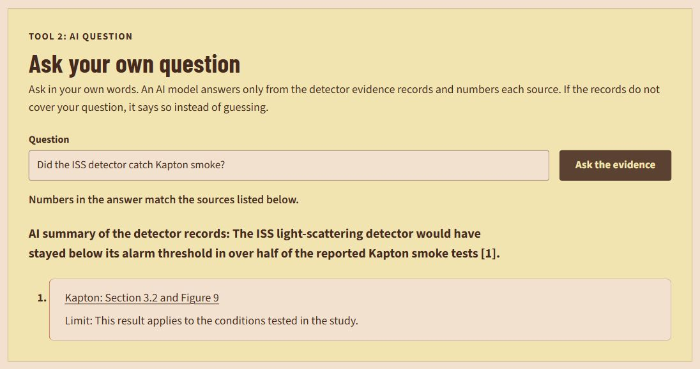

# Silent Alarm

Silent Alarm searches NASA combustion records and compares how spacecraft smoke detectors responded to materials such as Teflon and Kapton. We built it as Team Heat Sync for the NASA Space Apps Challenge 2026. [Live app](https://main.d10dgoqf0gsajx.amplifyapp.com/)  [Team Heat Sync](https://www.spaceappschallenge.org/2026/find-a-team/heat-sync/)  [Flame in Freefall](https://www.spaceappschallenge.org/2026/challenges/flame-in-freefall/)

## Use the live website

- **Investigations** ranks nine NASA records and can summarize the top three. [Search investigations](https://main.d10dgoqf0gsajx.amplifyapp.com/investigations.html)
- **Detector Evidence** shows the finding, available test conditions, and a CSV for the selected material. [Compare Teflon and Kapton](https://main.d10dgoqf0gsajx.amplifyapp.com/detector-evidence.html)
- **Smoke Analysis** has the detector comparison, a chart of eight particle-size measurements at baseline and after 720 seconds, and a separate CSV for those measurements. [Open Smoke Analysis](https://main.d10dgoqf0gsajx.amplifyapp.com/smoke-analysis.html)

## Try the Kapton question

On **Smoke Analysis**, enter `Did the ISS detector catch Kapton smoke?` under **Ask your own question**. This answer from the live app links to Figure 9 and keeps the finding tied to the reported test conditions.

## Where the evidence stops

On **Smoke Analysis**, pick Teflon, set the environment to **Moon gravity**, and click **Rank evidence**. The page shows the gap in lunar-gravity detector data, links NASA's LUCI material-flammability results, and proposes a detector test with matched airflow, smoke age, oxygen concentration, and pressure. [Smoke Analysis](https://main.d10dgoqf0gsajx.amplifyapp.com/smoke-analysis.html) · [LUCI flight results](https://ntrs.nasa.gov/citations/20250010653)

## The three parts we needed help with

Claude and Codex helped us mainly with these three parts of the implementation.

### Keeping answers tied to the records

Lambda sends the question and a set of NASA records to `openai/gpt-oss-120b`. It asks for a citation on each sentence, such as `(PSI-102)` or `[kapton-iss-alarm]`. It drops uncited sentences and rejects the answer if a remaining citation points outside the records it sent. A valid ID gives you a record to check when you read the summary.

The Kapton question sometimes came back as “insufficient evidence” even when the model had cited the right record. The citation parser now handles Unicode dashes and wide brackets. The detector API has separate reasons for `no_evidence`, `empty`, and `uncited`. An empty answer gets one retry.

### Calling Groq from a static site

We tried Bedrock first and ran into the account's quota. The four HTML pages still run on Amplify, with a small Python service in [the Lambda handler](lambda/lambda_function.py). The `GROQ_API_KEY` lives in Lambda's settings. The public Function URL needed both invoke permissions. CORS lets the Amplify site read the responses. The handler reads the JSON served by Amplify and caches it on warm invocations. Rapid testing can hit Groq's free-plan limit of 30 requests per minute. [AWS Function URL permissions](https://docs.aws.amazon.com/lambda/latest/dg/urls-auth.html) · [Groq rate limits](https://console.groq.com/docs/rate-limits)

### Making ranking work after the page split

MiniLM and Transformers.js are pinned. The browser ranks records by cosine similarity, with direct detector evidence listed before related records. Changing a selection throws away the old run. If the model fails to load, the page falls back to a fixed order.

After we split the site, the shared ranking file tried to attach events to detector controls that weren't on the Investigations page. It now checks for those controls. We versioned the script URLs so browsers fetch the updated modules.

## Sources

**NASA PSI records**

- Smoke and aerosol experiments. [SAME and the Teflon test conditions, PSI-102](https://psi.nasa.gov/physci/repo/data/investigations/PSI-102), [SAME Reflight, PSI-101](https://psi.nasa.gov/physci/repo/data/investigations/PSI-101), [DAFT / DAFT-2, PSI-47](https://psi.nasa.gov/physci/repo/data/investigations/PSI-47).
- Material flammability and suppression. [BASS, PSI-26](https://psi.nasa.gov/physci/repo/data/investigations/PSI-26), [BASS-II, PSI-25](https://psi.nasa.gov/physci/repo/data/investigations/PSI-25), [Saffire-I, PSI-98](https://psi.nasa.gov/physci/repo/data/investigations/PSI-98), [FLEX, PSI-69](https://psi.nasa.gov/physci/repo/data/investigations/PSI-69).
- ACME investigations. [Burning Rate Emulator, PSI-20](https://psi.nasa.gov/physci/repo/data/investigations/PSI-20), [Cool Flames Investigation with Gases, PSI-159](https://psi.nasa.gov/physci/repo/data/investigations/PSI-159).

Meyer et al.'s 2018 paper *Evaluation of Spacecraft Smoke Detector Performance in the Low-Gravity Environment* is the source for the ISS alarm-threshold findings. [Section 3.2 and Figure 9](https://pmc.ncbi.nlm.nih.gov/articles/PMC7918997/#F9) · [DOI](https://doi.org/10.1016/j.firesaf.2018.04.004)

Urban et al.'s *SAME Final Report* provides the ISS and Space Shuttle signals from Teflon Test 25. It also provides the arithmetic mean diameters used in the chart and CSV. [Figure 12 for Test 25](https://tsapps.nist.gov/publication/get_pdf.cfm?pub_id=904707#page=24) · [Table 1 for particle size](https://tsapps.nist.gov/publication/get_pdf.cfm?pub_id=904707#page=25)

The lunar context comes from Ferkul et al.'s Lunar Combustion Investigation. The home page's Artemis II account comes from Reid Wiseman's April 16, 2026 crew news conference. [NASA LUCI flight results](https://ntrs.nasa.gov/citations/20250010653) · [NASA Artemis II recording, 46:23](https://www.youtube.com/watch?v=_43Ei9eQVww&t=2783s)

## Design and tools

The layout draws on a template from the [21st.dev Templates gallery](https://21st.dev/community/templates). The Heat Sync logo is AI-generated and credited in the site footer. The two typefaces are Barlow Condensed and Source Sans 3 under the SIL Open Font License 1.1. [Barlow Condensed license](https://github.com/google/fonts/blob/main/ofl/barlowcondensed/OFL.txt) · [Source Sans 3 license](https://github.com/adobe-fonts/source-sans/blob/release/LICENSE.md)

The browser uses Transformers.js 3.8.1 and the pinned Xenova build of `all-MiniLM-L6-v2`, both Apache 2.0. The static site is hosted on AWS Amplify and Lambda calls Groq for model answers. [Transformers.js](https://github.com/huggingface/transformers.js/tree/3.8.1) · [Pinned MiniLM model](https://huggingface.co/Xenova/all-MiniLM-L6-v2/tree/751bff37182d3f1213fa05d7196b954e230abad9) · [Amplify](https://docs.aws.amazon.com/amplify/latest/userguide/welcome.html) · [Groq model](https://console.groq.com/docs/model/openai/gpt-oss-120b)
